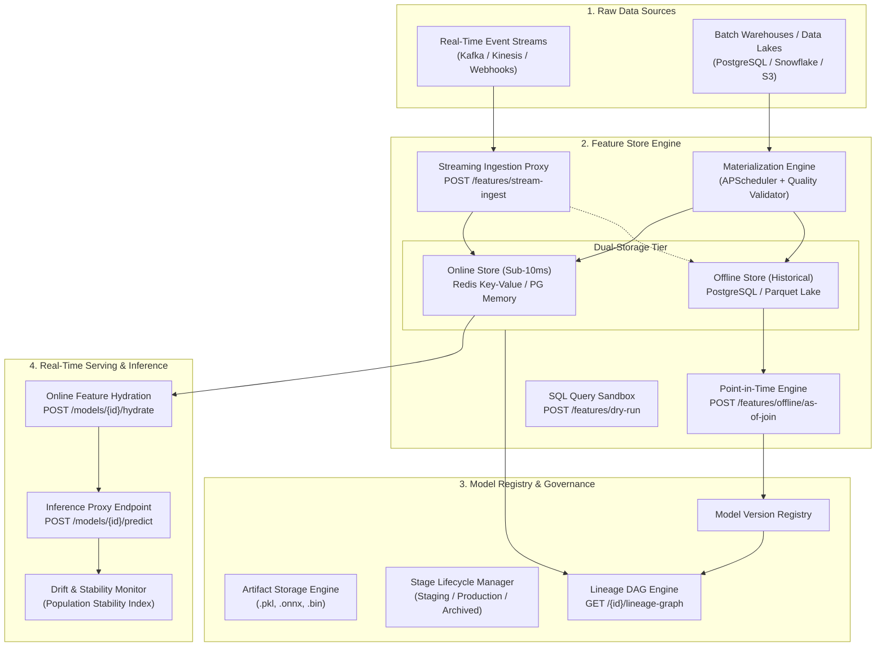

# Enterprise Feature Store & Model Registry: End-to-End Architectural Blueprint (A to Z)

> Implementation status: P0 corrections are implemented and verified; see [P0 operation guide](P0_IMPLEMENTATION.md). Broader P1/P2 work remains. Executable serving currently supports registered JSON linear/logistic models.

---

## 1. Executive Summary

A modern, enterprise-grade Feature Store and Model Registry acts as the foundational data and governance platform for operational machine learning. It bridges the critical divide between **data engineering** (batch and streaming transformations) and **real-time ML serving** (ultra-low latency online feature hydration, inference scoring, and drift detection).

This document serves as the exhaustive architectural blueprint and reference specification for running and extending the platform end-to-end.

---

## 2. The 10 Architectural Pillars of the Complete System

### Pillar 1: Feature Definition & Interactive SQL Sandbox
- **Core Problem**: Writing SQL transformations for feature derivation often results in broken materialization jobs due to unvalidated syntax or missing entity keys.
- **Implementation**:
  - `POST /features/dry-run`: Runs exploratory SQL with strict limits (`LIMIT 10`) within an isolated transaction.
  - Guardrails: Restricts DDL/DML operations (`DROP`, `DELETE`, `UPDATE`, `ALTER`, `TRUNCATE`) while inferring column schemas and measuring query execution latency in real-time.
  - Interactive UI Sandbox in `FeatureCatalog.jsx`: Allows engineers to verify query output columns before committing feature definitions.

### Pillar 2: Dual Storage Tier (Online vs. Offline)
- **Online Store (Low Latency Serving)**:
  - Backends: **PostgreSQL** (`feature_store.feature_values_online`) and **Redis** (`RedisOnlineStore`).
  - Architecture: Keys are indexed by `fs:{feature_id}:{entity_key}` with TTL support and pipelined `MGET` batch retrieval achieving sub-10ms latency.
  - Graceful Fallback: The system automatically falls back to PostgreSQL if the in-memory cache is temporarily unreachable.
- **Offline Store (Historical Time Series)**:
  - Stores all historical feature value transitions with timestamps (`feature_store.feature_values_offline`).
  - Supports analytical queries, training set generation, and historical data exploration.

### Pillar 3: Leakage-Free Point-in-Time Correct (As-Of) Join Engine
- **Core Problem**: Machine learning models trained on features containing data from *after* the observation timestamp suffer from target leakage, causing models to perform well in training but fail disastrously in production.
- **Implementation**:
  - `POST /features/offline/as-of-join`: Computes exact point-in-time joins:
    $$\max(\text{event\_time}) \quad \text{where} \quad \text{event\_time} \le \text{observation\_time}$$
  - Takes an observation frame (entity keys and event timestamps) and joins historical feature states without lookahead bias.

### Pillar 4: Active Data Quality & Schema Validation
- **Runtime Rules Enforcement**:
  - `FeatureDefinition.validation_rules_json`: Supports assertions such as `min_value`, `max_value`, `allow_null: false`, and type checking.
  - During materialization runs (`app/services/materialization.py`), rows violating constraints are logged, and error states are recorded in `feature_store.feature_materialization`.

### Pillar 5: Model Registry & Artifact Storage Engine
- **Version Control**:
  - Semantic versioning of models (`v1.0`, `v1.1`, `v2.0`).
  - Stage transitions (`Staging`, `Production`, `Archived`) with strict audit trails (`model_registry.model_stage_history`).
- **Binary Artifact Management**:
  - `POST /models/{id}/versions/{v}/artifact`: Multi-part binary upload supporting `.pkl`, `.onnx`, `.bin`, `.tar.gz`.
  - `GET /models/{id}/versions/{v}/artifact`: Streaming binary download for model deployment.

### Pillar 6: Real-Time Feature Hydration & Inference Proxy
- **Online Feature Hydration (`POST /models/{id}/hydrate`)**:
  - Maps model features to active online store values for requested entities.
  - Produces pre-aligned, normalized feature vectors ready for model consumption.
- **Inference Proxy (`POST /models/{id}/predict`)**:
  - Takes an entity key and optional runtime features (e.g. `request_channel`, `device_type`), automatically hydrates all online features from cache, executes model scoring, and returns prediction classes with probabilities.

### Pillar 7: End-to-End Lineage & Visual DAG
- **Full Traceability**:
  - Maps `Source Tables` ➔ `Feature Definitions` ➔ `Feature Groups` ➔ `Model Versions` ➔ `Production Endpoints`.
  - APIs: `GET /features/{id}/lineage-graph` and `GET /models/{id}/lineage-graph`.
  - Interactive UI: Visual DAG component (`LineageGraph.jsx`) with node color-coding, status indicators, and connector paths.

### Pillar 8: Statistical Drift & Distribution Monitoring (PSI)
- **Population Stability Index (PSI)**:
  - Continuously monitors online inference feature distributions against baseline training distributions:
    $$\text{PSI} = \sum_{b=1}^{B} \left( \text{Actual}_b - \text{Expected}_b \right) \times \ln\left( \frac{\text{Actual}_b}{\text{Expected}_b} \right)$$
  - Thresholds:
    - $\text{PSI} < 0.1$: No significant change / Stable.
    - $0.1 \le \text{PSI} < 0.2$: Moderate drift / Warning.
    - $\text{PSI} \ge 0.2$: Critical distribution drift / Retrain required.

### Pillar 9: Python SDK & CLI Automation
- Standalone Python package (`sdk/featurestore/`):
  - `FeatureStoreClient`: Full programmatic control for Data Scientists in Jupyter / Colab.
  - Subcommands: `login`, `features`, `models`, `get-online`, `stream-ingest`, `predict`.

### Pillar 10: Enterprise Production Readiness
- **Security & Multi-Tenancy**:
  - RBAC: `Admin`, `ML Engineer`, `Data Scientist`, `Analyst`.
  - API Keys with SHA-256 hashing and instant copy.
  - Full audit logging (`core.audit_log`).
- **CI/CD & Self-Hosting**:
  - GitHub Actions automated matrix testing (`.github/workflows/ci.yml`).
  - Production `docker-compose.yml` with healthchecks.

---

## 3. End-to-End Workflow Checklist (A to Z)

| Step | Action | Endpoint / Command | Tool / Layer |
|---|---|---|---|
| **1. Auth** | Generate API Key or login via JWT | `POST /auth/login` | Backend Auth / UI |
| **2. Explore** | Test SQL queries in read-only sandbox | `POST /features/dry-run` | SQL Engine / UI Modal |
| **3. Define** | Register Feature Groups and Definitions | `POST /features` | Feature Store |
| **4. Ingest** | Stream real-time events into online tier | `POST /features/stream-ingest` | SDK / Ingestion API |
| **5. Materialize** | Trigger scheduled batch aggregations | `POST /features/{id}/materialize` | APScheduler |
| **6. Dataset** | Generate point-in-time training data | `POST /features/offline/as-of-join` | As-Of Join Engine |
| **7. Train** | Train ML model on historical features | `scikit-learn` / `xgboost` | Training Script / Notebook |
| **8. Register** | Register model version & upload weights | `POST /models/{id}/versions/{v}/artifact` | Model Registry |
| **9. Promote** | Promote model version to Production | `PATCH /models/{id}/versions/{v}/stage` | Governance UI / API |
| **10. Hydrate** | Look up low-latency features in real-time | `POST /models/{id}/hydrate` | Online Store (Redis/PG) |
| **11. Score** | Execute real-time prediction via proxy | `POST /models/{id}/predict` | Inference Proxy |
| **12. Monitor** | Track drift and view Lineage DAG | `GET /models/{id}/drift`, `lineage-graph` | Observability UI |
