# Training-to-serving system flow

This document describes implemented behavior. Runtime and capacity boundaries are in [README](../README.md) and [performance](PERFORMANCE.md).

```mermaid
flowchart LR
    Console[React console and Python SDK] --> API[FastAPI and authorization]
    API --> Source[Restricted PostgreSQL SELECT reader]
    Source --> Refresh[Validated chunked atomic refresh]
    API --> Push[HTTP event ingestion]
    Refresh --> PostgreSQL[Online values and indexed historical values]
    Push --> PostgreSQL
    PostgreSQL --> Cache[Revision keyed Redis cache]
    PostgreSQL --> Join[Point in time training join]
    Join --> Training[External model training]
    Training --> Registry[Version and managed JSON artifact]
    Cache --> Hydrate[Signature based hydration]
    PostgreSQL --> Hydrate
    Registry --> Predict[Linear or logistic runtime]
    Hydrate --> Predict
    Predict --> Observations[Persisted inference observations]
    Observations --> PSI[Explicit PSI against fixed training baseline]
```

## Define and ingest

Create a scoped feature group, then a feature definition with SQL returning `entity_key`, `value`, and preferably `event_time`. Declared types and numeric/null rules are enforced. Preview uses a separate unprivileged database login, read-only transactions, timeouts and at most 50 rows. Operators grant only approved source objects.

Materialization opens a server-side cursor and validates/writes chunks, keeping the value changes in one transaction. It advances the feature revision once and replaces that feature's online snapshot. Offline history remains append-only for new event timestamps. Any invalid row, source failure or conflicting replay rolls back the refresh, including earlier chunks; the failure record is persisted separately. The default source limit is 100,000 rows and chunk size 1,000.

Streaming uses `POST /features/stream-ingest`, optionally persisting offline history. Same entity/feature/time with the same value is a no-op; a different value rejects the batch. A late event can enter history while leaving newer online values intact. A refresh intentionally replaces the current snapshot rather than merging deleted entities back in.

## Reconstruct and train

Call `POST /features/offline/as-of-join` with observations and feature references. A single PostgreSQL lateral-lookup statement selects each latest value at or before the observation timestamp, preserving observation order, duplicates and missing values. A covering index serves entity/feature/time lookups. This prevents selecting future event timestamps; it does not implement bitemporal ingestion-time reconstruction.

Resolve features by UUID, unique name, `group:name`, or `environment/group:name`. Ambiguous names fail explicitly. Historical and online frames have bounded request sizes. Use the examples to train outside the service, register a model/version, link feature IDs and upload a `featureops.linear.v1` artifact with learned weights and an ordered typed signature.

## Serve and measure

Hydration resolves the selected version's signature. Runtime-only values must be declared and cannot replace stored feature inputs. Prediction executes JSON linear regression or binary logistic scoring. Missing inputs/artifacts, unsupported formats and invalid values fail explicitly. Only successful predictions create inference observations.

PostgreSQL is authoritative. Cache keys include the committed feature revision; streaming publication occurs after commit and misses fall back to PostgreSQL and refill that generation. Refreshes warm on read to avoid retaining all rows in a publication queue. Old generations expire by TTL.

Capture an immutable numeric training baseline for a version, then explicitly measure PSI over an inference-observation UTC window. Histories contain actual stored runs. Insufficient or missing observations remain unknown, while identical distributions can produce zero. There is no automatic retraining or drift scheduler.

## Govern and recover

Version identities are unique per model and at most one version is Production. Promotions serialize and record stage/audit changes atomically. User creation commits roles and audit together. API keys inherit their owner's role and can be revoked.

Cron definitions validate at creation/edit. Workers refresh schedules, use advisory locks, and reserve durable UTC scheduled-minute slots. Manual triggers remain possible while a schedule is paused. Interrupted slots require an operator-selected retry; no exactly-once external side effects are promised.

Lineage derives from registered source records, feature links and consumer versions. Unknown sources are labelled explicitly. Use [operations](OPERATIONS.md) for health checks, database/artifact backup and restore, and [performance](PERFORMANCE.md) for capacity and retention planning.
