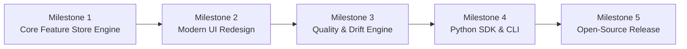

# Project Roadmap & Production Milestones

This document details the comprehensive audit, gaps identified, architectural requirements, and milestone plan to transition the **Feature Store & Model Registry** into an enterprise-grade, open-source project with a redesigned, professional UI.

---

## 1. Deep Codebase Audit & Gap Analysis

Following an extensive review of the backend services, schemas, API routes, database models, and frontend client, the following critical gaps and technical debt were identified:

### 1.1 Backend & Machine Learning Serving Gaps

1. **No Real-Time Batch Online Inference API (`get_online_features`)**:
   - *Current State*: The API only exposes `GET /features/{feature_id}/values`, which returns up to 100 historical values for a single feature.
   - *Requirement*: True feature stores (Feast, Hopsworks, Tecton) provide a multi-entity, multi-feature batch lookup: `POST /features/online/batch` accepting `entity_keys: list[str]` and `feature_names: list[str]`. This is the fundamental requirement for low-latency model inference.
2. **Missing Point-in-Time Correct (As-Of) Offline Join Engine**:
   - *Current State*: Offline data is stored in `feature_store.feature_values_offline`, but there is no mechanism to produce point-in-time correct training datasets.
   - *Requirement*: A point-in-time join engine (preventing data leakage by matching features as of the event timestamp on training observation data).
3. **Validation Rules Are Ignored During Materialization**:
   - *Current State*: `FeatureDefinition` includes `validation_rules_json`, but `materialize_feature()` executes raw SQL without ever validating null checks, bounds, types, or anomalous distributions.
   - *Requirement*: Data quality assertions during materialization (fail fast or alert when data violates schema rules).
4. **Mock Drift Engine (`random.uniform` in `models.py`)**:
   - *Current State*: `GET /models/{model_id}/drift` generates dummy features (`["transaction_count", "days_active", ...]`) and returns fake numbers using `random.uniform()`.
   - *Requirement*: Real statistical drift monitoring: Population Stability Index (PSI), Wasserstein Distance, or Kolmogorov-Smirnov (KS) test comparing offline baseline distributions with online inference logs.
5. **No Model Artifact Storage Engine**:
   - *Current State*: Model versions store an `artifact_uri` as a plain string without storage integration.
   - *Requirement*: S3/MinIO/Supabase Storage integration for uploading, versioning, and downloading model weights (`.onnx`, `.pkl`, `.bin`).
6. **No Real-Time / Streaming Ingestion Engine**:
   - *Current State*: Materialization runs only via batch SQL queries through APScheduler.
   - *Requirement*: A streaming push endpoint (`POST /features/stream-ingest`) or Kafka/webhook consumer to update the online store in real time.
7. **Zero Test Coverage**:
   - *Current State*: No unit tests, integration tests, or mock fixtures exist in the repository.
   - *Requirement*: Pytest test suite covering authentication, RBAC, feature materialization, model versioning, and API endpoints.

---

### 1.2 Frontend & UI/UX Audit: "AI Slop" Purge

The current frontend has multiple characteristics commonly associated with quick AI generation rather than intentional design engineering:

| AI Slop Symptom | Current Code Evidence | Redesign Solution |
|---|---|---|
| **Stylistic Chaos & Random Palette** | `styles.css` (967 lines) mixes `Space Grotesk` with `Newsreader` (an editorial book serif font used randomly on headers), pastel gradients (`--sun`, `--coral`, `--mint`), and fake dot grid overlays. | Migrate to **Tailwind CSS** with a modern, clean, minimal design system (Linear / Vercel / Databricks aesthetic) and system dark/light modes. |
| **Component Code Duplication** | Inline `<Modal>` redefined in 4 separate files (`Admin.jsx`, `Jobs.jsx`, `ModelDetail.jsx`, `FeatureCatalog.jsx`). `<TabButton>` duplicated in 3 files. `statusColor()` duplicated in 3 files with inconsistent hex codes. | Implement shared, accessible UI primitives using **Radix UI** or **shadcn/ui** components (`Dialog`, `Tabs`, `Badge`, `DropdownMenu`). |
| **Hand-Rolled SVG Bloat** | `Icons.jsx` contains 321 lines of custom SVG definitions despite `lucide-react` already being installed in `package.json`. | Remove `Icons.jsx` completely; use standard `lucide-react` icons directly. |
| **Fake & Hardcoded Metrics** | Dashboard hardcodes `"98%"` for data freshness and shows raw truncated UUID strings (`item.name.slice(0, 8)`). Drift charts use raw `<svg viewBox="0 0 300 100">` polylines connected to random numbers. | Replace with genuine data aggregation; integrate **Recharts** or **Visx** for production-grade, interactive charts. |
| **Client-Side N+1 Waterfalls** | `Jobs.jsx` executes `Promise.all(data.map(async (job) => fetchApi(...)))` on mount, triggering an unbatched storm of HTTP requests. | Create unified backend aggregation endpoints and use **TanStack Query (React Query)** for client-side caching, deduping, and optimistic updates. |
| **Silent Error Swallowing** | Almost every asynchronous handler uses `catch { // ignore }`. When operations fail, users see no feedback or error state. | Add global toast notifications (**Sonner**) and error boundaries with retry mechanisms. |
| **Monolithic Page Files** | `ModelDetail.jsx` (495 lines), `FeatureDetail.jsx` (435 lines), and `Admin.jsx` (422 lines) bundle tabs, forms, modals, table rendering, and chart math into single files. | Break down each page into domain-driven sub-components (`components/features/`, `components/models/`, `components/jobs/`). |

---

### 1.3 Open-Source Readiness Gaps

To release this project to the open-source community, the following institutional assets are missing:

1. **Licensing**: No `LICENSE` file (Apache 2.0 or MIT recommended).
2. **Community Guidelines**: No `CONTRIBUTING.md`, `CODE_OF_CONDUCT.md`, or `SECURITY.md`.
3. **Python Client SDK**: Data scientists need a Python client package (`pip install featurestore-client`) to connect from Jupyter notebooks, Airflow, and training scripts.
4. **CI/CD Pipeline**: No GitHub Actions workflows for automated linting, type checks, and tests across Python/Node matrices.
5. **Code Hygiene & Pre-Commit**: No pre-commit hooks, Ruff/Black configs, or ESLint/Prettier formatting standards.
6. **Self-Hosting Docker Setup**: Complete `docker-compose.yml` for running the entire stack locally (Backend, Frontend, Postgres, and Redis) with one command.

---

## 2. Project Milestones



---

### Milestone 1: Core Feature Store Engine & Backend Hardening
**Objective**: Transform CRUD database wrappers into a genuine feature store serving low-latency inference and training datasets.

- [ ] **Batch Online Retrieval API**:
  - Implement `POST /features/online/batch` endpoint.
  - Accept `entity_keys: list[str]` and `features: list[str]` (format: `group:feature_name`).
  - Return columnar JSON or vector dictionary with serving latency metrics.
- [ ] **Point-in-Time Correct (As-Of) Offline Dataset Generator**:
  - Implement `POST /features/offline/as-of-join`.
  - Accept observation entity keys and timestamps to reconstruct historic state without data leakage.
- [ ] **Redis Online Store Adapter**:
  - Introduce an abstract Online Store Interface (`PostgresOnlineStore` vs. `RedisOnlineStore`).
  - Add optional Redis caching for sub-5ms feature serving.
- [ ] **Comprehensive Test Suite**:
  - Setup Pytest with PostgreSQL test containers or SQLite test DB.
  - Test authentication, RBAC authorization guards, materialization pipeline, and API endpoints.

---

### Milestone 2: Complete UI/UX Redesign (Purging AI Slop)
**Objective**: Build a clean, enterprise-grade, accessible dashboard with no duplicate components, fake visuals, or messy CSS.

- [ ] **Design System & Tooling Setup**:
  - Configure **Tailwind CSS** with a polished neutral design system (zinc/slate palette, dark/light theme).
  - Install **shadcn/ui** or **Radix UI** primitives (`Button`, `Dialog`, `DropdownMenu`, `Tabs`, `Badge`, `Card`, `Tooltip`).
  - Replace `Icons.jsx` with direct `lucide-react` imports.
- [ ] **Component Architecture Modernization**:
  - Extract reusable `<DataTable>` with sorting, pagination, and search filtering using **TanStack Table**.
  - Install **Sonner** for toast feedback (replace silent error swallowing with meaningful alerts).
  - Adopt **TanStack Query** for network caching, background refetching, and eliminating N+1 request waterfalls.
- [ ] **Page Rebuilds**:
  - **Dashboard**: Real KPI summaries, live materialization stream, stage promotion activity.
  - **Feature Catalog & Detail**: Interactive SQL editor (Monaco or CodeMirror), dependency lineage graph, live online feature test inspector.
  - **Model Registry & Detail**: Real metric comparison across versions, stage promotion modal with confirmation logs.
  - **Jobs & Scheduler**: Cron expression validator helper, live job run logs with auto-scroll.
  - **Administration**: User management, RBAC assignment, audit log viewer with JSON payload explorer, API key generator.

---

### Milestone 3: Real Data Quality, Drift & Storage Engine
**Objective**: Replace mocked drift and ignored validation with real statistical validation and artifact storage.

- [ ] **Active Validation Engine**:
  - Enforce `validation_rules_json` during `materialize_feature()` (null thresholds, type checks, min/max bounds).
  - Record validation reports in a new `feature_store.feature_validation_run` table.
- [ ] **Real Statistical Drift Calculation**:
  - Replace `random.uniform()` in `get_model_drift`.
  - Implement real Population Stability Index (PSI) algorithm comparing training distribution bins against inference distributions.
- [ ] **Model Artifact Management**:
  - Add storage provider interface (Supabase Storage, AWS S3, MinIO, or Local filesystem).
  - Endpoints for model artifact upload (`POST /models/{id}/versions/{v}/artifact`) and secure presigned download.

---

### Milestone 4: Python Client SDK & CLI
**Objective**: Empower ML engineers and data scientists to interact with the Feature Store directly from Python code and CI/CD pipelines.

- [ ] **Python SDK (`featurestore-sdk`)**:
  ```python
  from featurestore import FeatureStoreClient

  client = FeatureStoreClient(api_url="http://localhost:8000", api_key="fo_xxx")
  
  # Fetch online features for real-time model inference
  features = client.get_online_features(
      entity_keys=["cust_001", "cust_002"],
      features=["payments:customer_30d_spend", "user:account_age"]
  )
  
  # Log model version
  client.register_model_version(
      model_name="Churn Predictor",
      version="1.1",
      metrics={"roc_auc": 0.94},
      artifact_path="./model.pkl"
  )
  ```
- [ ] **CLI Tool (`featurestore-cli`)**:
  - Commands for `fs login`, `fs features list`, `fs materialise <id>`, `fs models list`.

---

### Milestone 5: Open-Source Governance, Packaging & Launch
**Objective**: Prepare repository for public open-source release with clear documentation and automated CI/CD.

- [ ] **Legal & Community Standards**:
  - Add `LICENSE` (Apache 2.0).
  - Add `CONTRIBUTING.md` (development workflow, PR guidelines).
  - Add `CODE_OF_CONDUCT.md` and `SECURITY.md`.
- [ ] **Automated CI/CD Pipeline**:
  - GitHub Actions workflow for backend linting (Ruff), formatting (Black), and testing (Pytest).
  - GitHub Actions workflow for frontend linting (ESLint), build checks (Vite build), and type safety.
  - Docker automated image builds.
- [ ] **One-Click Self-Hosting Setup**:
  - Production `docker-compose.yml` deploying Backend, Frontend (Nginx), PostgreSQL, and Redis.
- [ ] **Documentation Site**:
  - Comprehensive documentation with quickstart, API references, architectural diagrams, and user guides.
