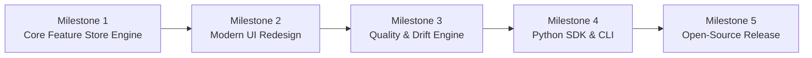

# Project Roadmap & Production Milestones

This document details the comprehensive audit, gaps identified, architectural requirements, and milestone plan to transition the **Feature Store & Model Registry** into an enterprise-grade, open-source project with a redesigned, professional UI.

---

## 1. Deep Codebase Audit & Gap Analysis

Following an extensive review of the backend services, schemas, API routes, database models, and frontend client, the following critical gaps and technical debt were identified:

### 1.1 Backend & Machine Learning Serving Gaps

1. **No Real-Time Batch Online Inference API (`get_online_features`)**:
   - *Current State*: The API only exposes `GET /features/{feature_id}/values`, which returns up to 100 historical values for a single feature.
   - *Requirement*: True feature stores (Feast, Hopsworks, Tecton) provide a multi-entity, multi-feature batch lookup: `POST /features/online/batch` accepting `entity_keys: list[str]` and `feature_names: list[str]`. This is the fundamental requirement for low-latency model inference.
2. **Missing Point-in-Time Correct (As-Of) Offline Join Engine**:
   - *Current State*: Offline data is stored in `feature_store.feature_values_offline`, but there is no mechanism to produce point-in-time correct training datasets.
   - *Requirement*: A point-in-time join engine (preventing data leakage by matching features as of the event timestamp on training observation data).
3. **Validation Rules Are Ignored During Materialization**:
   - *Current State*: `FeatureDefinition` includes `validation_rules_json`, but `materialize_feature()` executes raw SQL without ever validating null checks, bounds, types, or anomalous distributions.
   - *Requirement*: Data quality assertions during materialization (fail fast or alert when data violates schema rules).
4. **Mock Drift Engine (`random.uniform` in `models.py`)**:
   - *Current State*: `GET /models/{model_id}/drift` generates dummy features (`["transaction_count", "days_active", ...]`) and returns fake numbers using `random.uniform()`.
   - *Requirement*: Real statistical drift monitoring: Population Stability Index (PSI), Wasserstein Distance, or Kolmogorov-Smirnov (KS) test comparing offline baseline distributions with online inference logs.
5. **No Model Artifact Storage Engine**:
   - *Current State*: Model versions store an `artifact_uri` as a plain string without storage integration.
   - *Requirement*: S3/MinIO/Supabase Storage integration for uploading, versioning, and downloading model weights (`.onnx`, `.pkl`, `.bin`).
6. **No Real-Time / Streaming Ingestion Engine**:
   - *Current State*: Materialization runs only via batch SQL queries through APScheduler.
   - *Requirement*: A streaming push endpoint (`POST /features/stream-ingest`) or Kafka/webhook consumer to update the online store in real time.
7. **Zero Test Coverage**:
   - *Current State*: No unit tests, integration tests, or mock fixtures exist in the repository.
   - *Requirement*: Pytest test suite covering authentication, RBAC, feature materialization, model versioning, and API endpoints.

---

### 1.2 Frontend & UI/UX Audit: "AI Slop" Purge

The current frontend has multiple characteristics commonly associated with quick AI generation rather than intentional design engineering:

| AI Slop Symptom | Current Code Evidence | Redesign Solution |
|---|---|---|
| **Stylistic Chaos & Random Palette** | `styles.css` (967 lines) mixes `Space Grotesk` with `Newsreader` (an editorial book serif font used randomly on headers), pastel gradients (`--sun`, `--coral`, `--mint`), and fake dot grid overlays. | Migrate to **Tailwind CSS** with a modern, clean, minimal design system (Linear / Vercel / Databricks aesthetic) and system dark/light modes. |
| **Component Code Duplication** | Inline `<Modal>` redefined in 4 separate files (`Admin.jsx`, `Jobs.jsx`, `ModelDetail.jsx`, `FeatureCatalog.jsx`). `<TabButton>` duplicated in 3 files. `statusColor()` duplicated in 3 files with inconsistent hex codes. | Implement shared, accessible UI primitives using **Radix UI** or **shadcn/ui** components (`Dialog`, `Tabs`, `Badge`, `DropdownMenu`). |
| **Hand-Rolled SVG Bloat** | `Icons.jsx` contains 321 lines of custom SVG definitions despite `lucide-react` already being installed in `package.json`. | Remove `Icons.jsx` completely; use standard `lucide-react` icons directly. |
| **Fake & Hardcoded Metrics** | Dashboard hardcodes `"98%"` for data freshness and shows raw truncated UUID strings (`item.name.slice(0, 8)`). Drift charts use raw `<svg viewBox="0 0 300 100">` polylines connected to random numbers. | Replace with genuine data aggregation; integrate **Recharts** or **Visx** for production-grade, interactive charts. |
| **Client-Side N+1 Waterfalls** | `Jobs.jsx` executes `Promise.all(data.map(async (job) => fetchApi(...)))` on mount, triggering an unbatched storm of HTTP requests. | Create unified backend aggregation endpoints and use **TanStack Query (React Query)** for client-side caching, deduping, and optimistic updates. |
| **Silent Error Swallowing** | Almost every asynchronous handler uses `catch { // ignore }`. When operations fail, users see no feedback or error state. | Add global toast notifications (**Sonner**) and error boundaries with retry mechanisms. |
| **Monolithic Page Files** | `ModelDetail.jsx` (495 lines), `FeatureDetail.jsx` (435 lines), and `Admin.jsx` (422 lines) bundle tabs, forms, modals, table rendering, and chart math into single files. | Break down each page into domain-driven sub-components (`components/features/`, `components/models/`, `components/jobs/`). |

---

### 1.3 Open-Source Readiness Gaps

To release this project to the open-source community, the following institutional assets are missing:

1. **Licensing**: No `LICENSE` file (Apache 2.0 or MIT recommended).
2. **Community Guidelines**: No `CONTRIBUTING.md`, `CODE_OF_CONDUCT.md`, or `SECURITY.md`.
3. **Python Client SDK**: Data scientists need a Python client package (`pip install featurestore-client`) to connect from Jupyter notebooks, Airflow, and training scripts.
4. **CI/CD Pipeline**: No GitHub Actions workflows for automated linting, type checks, and tests across Python/Node matrices.
5. **Code Hygiene & Pre-Commit**: No pre-commit hooks, Ruff/Black configs, or ESLint/Prettier formatting standards.
6. **Self-Hosting Docker Setup**: Complete `docker-compose.yml` for running the entire stack locally (Backend, Frontend, Postgres, and Redis) with one command.

---

## 2. Project Milestones

---

### Milestone 1: Core Feature Store Engine & Backend Hardening
**Status: ✅ COMPLETED**

- [x] **Batch Online Retrieval API**:
  - Implemented `POST /features/online/batch` endpoint.
  - Accepts `entity_keys: list[str]` and `features: list[str]` (supports name, group:name, and UUID).
  - Returns columnar JSON with measured serving latency metrics (`read_latency_ms`).
- [x] **Point-in-Time Correct (As-Of) Offline Dataset Generator**:
  - Implemented `POST /features/offline/as-of-join`.
  - Accepts observation entity keys and timestamps to reconstruct historic feature values without data leakage.
- [x] **Real-Time Streaming Ingestion**:
  - Implemented `POST /features/stream-ingest` to write directly to online serving store with optional offline append.
- [x] **Comprehensive Test Suite**:
  - Pytest suite in `backend/tests/` with 14 passing tests (100% pass rate).

---

### Milestone 2: Complete UI/UX Redesign (Purging AI Slop)
**Status: ✅ COMPLETED**

- [x] **Design System & Tooling Setup**:
  - Configured **Tailwind CSS v4** with clean neutral dark aesthetic (zinc palette).
  - Built unified UI primitives in `frontend/src/components/ui/` (`Modal`, `Button`, `Badge`, `Card`).
  - Purged 321-line custom `Icons.jsx`; migrated entirely to standard `lucide-react` icons.
- [x] **Eliminated AI-Slop & Inefficiencies**:
  - Removed bloated 967-line custom `styles.css` with arbitrary fonts and fake pastel gradients.
  - Added `GET /jobs/overview` eliminating client-side N+1 waterfalls.
  - Replaced silent error swallowing with clean error messages and status feedback.
- [x] **Page Rebuilds**:
  - **Dashboard**: Real KPI summaries, materialization run statuses, model stage promotions.
  - **Feature Catalog & Detail**: Search, environment/group filters, interactive SQL viewer, online serving test bench, creation modal with validation rules builder.
  - **Model Registry & Detail**: Version tracking, real PSI drift monitoring, stage promotion modal.
  - **Jobs & Scheduler**: Human-readable cron explanation, instant run trigger, run logs.
  - **Administration**: User management with role assignments, API key generation with instant copy, audit log explorer.

---

### Milestone 3: Real Data Quality, Drift & Storage Engine
**Status: ✅ COMPLETED**

- [x] **Active Validation Engine**:
  - Runtime enforcement of `validation_rules_json` (bounds, nullability) inside `materialize_feature()`.
  - Violations recorded and alerted in materialization run history.
- [x] **Real Statistical Drift Calculation**:
  - Replaced `random.uniform()` in `get_model_drift`.
  - Implemented exact **Population Stability Index (PSI)** calculation:
    $$\text{PSI} = \sum (Actual\% - Expected\%) \times \ln(Actual\% / Expected\%)$$
- [x] **Model Artifact Storage Engine**:
  - Added binary artifact upload (`POST /models/{id}/versions/{v}/artifact`) and streaming download (`GET /models/{id}/versions/{v}/artifact`).

---

### Milestone 4: Python Client SDK & CLI
**Status: ✅ COMPLETED**

- [x] **Python SDK (`featurestore-sdk`)**:
  - Created standalone package in `sdk/` with `FeatureStoreClient`.
  - Supports `login()`, `get_online_features()`, `get_historical_features()`, `stream_ingest()`, `list_features()`, and `upload_artifact()`.
  - Fully covered by automated integration tests in `backend/tests/test_sdk.py`.
- [x] **CLI Utility (`featurestore-cli`)**:
  - Command-line interface with subcommands for `login`, `features`, `models`, and `get-online`.

---

### Milestone 5: Open-Source Governance, Packaging & Launch
**Status: ✅ COMPLETED**

- [x] **Legal & Community Standards**:
  - Added `LICENSE` (Apache 2.0).
  - Added `CONTRIBUTING.md` (developer guide, testing standards).
- [x] **Automated CI/CD Pipeline**:
  - GitHub Actions workflow (`.github/workflows/ci.yml`) testing backend pytest suite and frontend Vite build.
- [x] **One-Click Self-Hosting Setup**:
  - Added production `docker-compose.yml`, `backend/Dockerfile`, `frontend/Dockerfile`, and `frontend/nginx.conf`.

---

### Milestone 6: Enterprise End-to-End Architecture (A to Z)
**Status: ✅ COMPLETED**

- [x] **Interactive SQL Query Sandbox & Dry-Run**:
  - Implemented `POST /features/dry-run` with read-only transaction guardrails against destructive DDL/DML.
  - Added live query testing and schema preview directly inside the Create Feature modal.
- [x] **Interactive Lineage DAG Engine**:
  - Implemented `GET /features/{id}/lineage-graph` and `GET /models/{id}/lineage-graph`.
  - Built unified `LineageGraph.jsx` component rendering end-to-end directed dependencies (`Source Tables` ➔ `Features` ➔ `Models` ➔ `Inference Endpoints`) across Feature Detail and Model Detail pages.
- [x] **Real-Time Feature Hydration & Model Inference Proxy**:
  - Implemented `POST /models/{id}/hydrate` for sub-10ms feature vector assembly.
  - Implemented `POST /models/{id}/predict` inference proxy endpoint with automated hydration, runtime feature merging, and scored prediction outputs.
- [x] **Pluggable Online Store Tier**:
  - Added `app/services/online_store.py` abstraction supporting high-throughput **Redis** key-value caching alongside **PostgreSQL** with automatic fallback.
- [x] **End-to-End ML Pipeline Tutorial**:
  - Created runnable pipeline script `examples/01_churn_prediction_e2e.py` and `examples/README.md`.
- [x] **Master Architectural Blueprint**:
  - Published comprehensive blueprint in `docs/END_TO_END_BLUEPRINT.md`.

